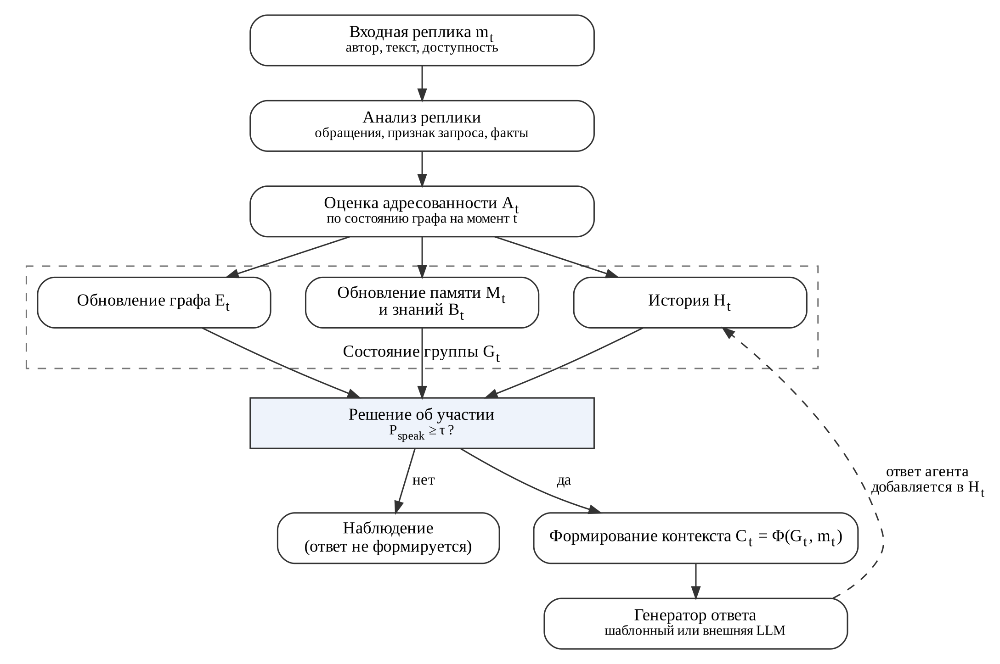
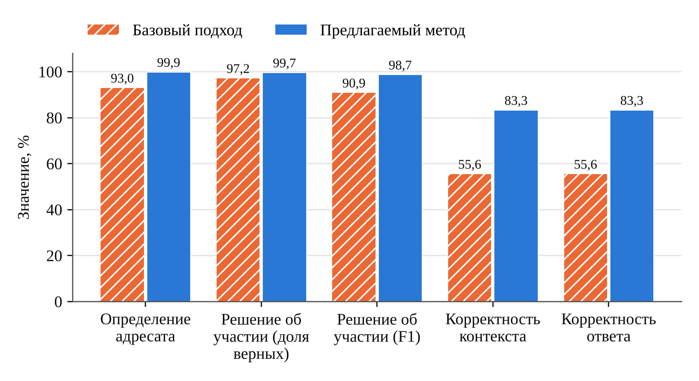

# GroupContextAgent

**Контекстно-зависимый агент для многопользовательского диалога** — исследовательский прототип, который отслеживает адресатов сообщений, историю взаимодействий и доступность фактов, чтобы решать, когда отвечать и какую информацию можно использовать.

Проект подготовлен в рамках НИР «Метод контекстного моделирования группового взаимодействия для LLM-агентов в многопользовательском диалоге».

> **Статус:** исследовательский прототип. Эксперименты выполнялись на синтетических сценариях; результаты не следует трактовать как гарантию безопасности или качества на реальных переписках.

## Что умеет агент

- **Определять адресатов реплик:** различать обращения к агенту, отдельному участнику и группе.
- **Хранить контекст группы:** использовать граф взаимодействий и обновляемую память фактов.
- **Учитывать доступность информации:** не использовать для ответа факты, недоступные участнику согласно модели видимости.
- **Решать, нужно ли отвечать:** оценивать вероятность участия агента в разговоре.
- **Сравнивать подходы:** запускать baseline, абляционные эксперименты и исследование с внешней LLM.

## Архитектура



Основные модули находятся в папке [`gca/`](gca/):

| Модуль | Назначение |
| --- | --- |
| `addressivity.py` | Оценка адресованности реплик |
| `graph.py` | Обновление графа взаимодействий |
| `memory.py` | Версионирование фактов и учёт их доступности |
| `context.py` | Сбор контекста для генерации ответа |
| `policy.py` | Решение об участии в диалоге |
| `generator.py` | Шаблонная генерация и OpenAI-совместимый адаптер |
| `agent.py` | Основной процесс обработки сообщений |

## Быстрый старт

**Требования:** Python 3.10+ (рекомендуется 3.11).

```bash
# 1. Клонировать репозиторий
# git clone https://github.com/<username>/GroupContextAgent.git
# cd GroupContextAgent

# 2. Создать и активировать виртуальное окружение
python -m venv .venv
# Linux/macOS:
source .venv/bin/activate
# Windows PowerShell:
# .venv\Scripts\Activate.ps1

# 3. Установить зависимости
python -m pip install -r requirements.txt

# 4. Запустить демонстрацию
python main.py data/demo_meeting.json
```

Для сравнения с базовым подходом:

```bash
python main.py data/demo_meeting.json --mode baseline
```

Для вывода итогового состояния группы в JSON:

```bash
python main.py data/demo_meeting.json --state
```

Пример вывода: [`docs/demo_output.txt`](docs/demo_output.txt). Основное ядро `gca/` использует стандартную библиотеку Python; зависимости в `requirements.txt` нужны для тестирования и визуализаций.

## Эксперименты и воспроизведение результатов

```bash
# Тесты
python -m pytest -q

# Пересоздать синтетический корпус и эталонную разметку
python -m experiments.corpus

# Сравнение baseline / proposed, абляция и анализ чувствительности
python -m experiments.run_all

# Построить графики из результатов
python -m experiments.plots

# Проверить конвейер LLM без скачивания модели
python -m experiments.run_llm --dry-run
```

Результаты сохраняются в [`results/`](results/), визуализации — в [`docs/`](docs/). Уже полученные результаты включены в репозиторий, поэтому графики можно просмотреть без запуска экспериментов.

### Результаты на синтетическом тестовом наборе

По сохранённому файлу [`results/results.json`](results/results.json):

| Метрика | Baseline | GroupContextAgent |
| --- | ---: | ---: |
| Точность адресации | 93,0% | **99,9%** |
| F1 решения об ответе | 90,9% | **98,7%** |
| Точность ответа (108 оцениваемых случаев) | 55,6% | **83,3%** |
| Случаи раскрытия недоступных сведений (24 проверочных случая) | 12 | **0** |



**Важно:** это оценки конкретного синтетического корпуса и правил проверки, а не показатели на реальном пользовательском трафике. Результаты отдельного LLM-эксперимента сохранены в `results/llm_qwen2.5_7b*.json`.

### Эксперимент с локальной LLM (Ollama)

В прототипе предусмотрен `OpenAICompatibleGenerator` для API, совместимого с OpenAI. Пример запуска с локальной моделью:

```bash
ollama pull qwen2.5:7b
# Убедитесь, что Ollama запущен
python -m experiments.run_llm --base-url http://localhost:11434/v1 --model qwen2.5:7b
python -m experiments.analyze_llm qwen2.5_7b
```

Для внешнего API можно указать другой `--base-url`, `--model` и `--api-key`. **Не добавляйте ключи и приватные диалоги в Git.** Запуск LLM требует работающего сервера модели; он не обязателен для демонстрации и тестов.

## Структура проекта

```text
GroupContextAgent/
├── gca/                   # Ядро агента
├── experiments/           # Корпус, оценивание, сравнения, графики и LLM
├── tests/                 # Автоматические тесты
├── data/                  # Синтетические тестовые диалоги и эталоны
├── docs/                  # Иллюстрации, схемы и пример вывода
├── results/               # Сохранённые результаты экспериментов
├── .github/workflows/     # CI-проверка тестов на GitHub
├── main.py                # CLI-демонстрация
├── requirements.txt
└── README.md
```

## Ограничения

Проект ориентирован на контролируемый синтетический корпус и небольшой набор типов фактов. Оценка адресованности и доступа основана на правилах прототипа; это не готовая система прав доступа или защиты конфиденциальной информации. Перед практическим использованием необходимы дополнительные тесты на реальных сценариях.

---

*Репозиторий содержит исходный код, синтетические данные и артефакты экспериментов для воспроизводимости результатов.*
